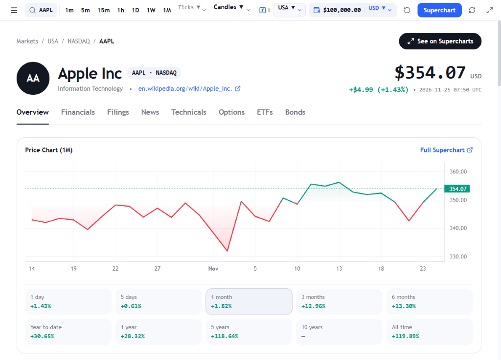
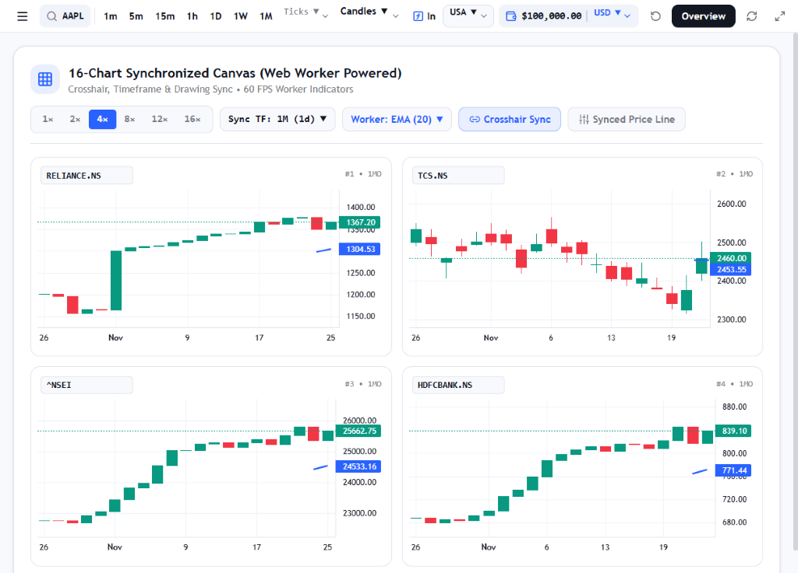

<p align="center">
  
</p>

<h1 align="center">Agam Paper Trading Platform</h1>

<p align="center">
  <strong>100% Free &amp; Open-Source Institutional Multi-Asset Paper Trading Terminal &amp; Global Fundamentals Workspace</strong>
</p>

<p align="center">
  
  
  
  
</p>

---

## Screenshots

### 1. Edge-to-Edge Superchart Terminal
Full-viewport workstation with `52px` drawing dock, floating OHLCV + inline `SELL | Spread | BUY` execution chips, 55+ chained indicators, live WebSocket quotes, collapsible multi-region Watchlist, and collapsible Paper Trading / Screener / Order Flow / Bar Replay drawer.


### 2. Symbol Overview & Fundamentals Analytics
Company profile, dual-currency live pricing, interactive Baseline chart with 10 rolling performance pills (`1D` to `ALL`), financial statements (`Income`, `Balance Sheet`, `Cash Flow`, `Debt Coverage`), and real-time Google News RSS stream.



### 3. 16-Chart Synchronized Multi-Asset Canvas
Up to 16 synchronized charts (`1×` to `16×`) with crosshair sync, synced price lines, and Web Worker-offloaded indicator computation (`EMA`, `Bollinger Bands`, `EMA of RSI`).



---

## Key Features

- **5 Global Market Regions (26,000+ Live Instruments)**:
  - **India (`IND`)**: NSE & BSE Equities, ETFs, Indices, Futures, FX, G-Secs & Bonds
  - **USA (`USA`)**: NASDAQ, NYSE, AMEX Equities, ETFs, Indices, Futures, Treasuries
  - **Canada (`CANADA`)**: TSX & TSXV Equities & ETFs
  - **China (`CHINA`)**: SSE & SZSE A-Shares, ETFs & CGBs
  - **Europe & UK (`EU`)**: LSE, Deutsche Börse (XETRA), Euronext, Borsa Italiana
- **Multi-Currency Paper Trading Engine (SQLite Persisted)**:
  - Isolated virtual wallets for `INR`, `USD`, `CAD`, `CNY`, `EUR`, and `GBP`
  - Instant inline Bid/Ask execution, full Order Ticket (Market, Limit, Stop-Loss, Take-Profit), Long/Short netting, and 1-click Reset
- **55+ Technical Indicators & Chained Calculations**:
  - `SMA`, `EMA`, `RSI`, `MACD`, `Bollinger Bands`, `ATR`, `VWAP`, chained `EMA(RSI)`, candlestick pattern detection, and earnings/dividend/split axis markers
- **Order Flow & Isolated Bar Replay**:
  - Real-time Volume Profile (`POC`, `VAH`, `VAL`), TPO Market Profile, Bid×Ask Footprint, and isolated Bar Replay studio (`1x`, `3x`, `10x`)
- **Full-Market Polars Columnar Screener & Non-Expiring Alerts**:
  - Sub-second vectorized multi-region screening + persistent `O(log N)` price/RSI alert rules
- **Zero Paid API Keys**:
  - Powered by asynchronous Google Finance scraping, public exchange masters, and real-time Google News RSS streams

---

## Tech Stack

- **Frontend**: Next.js 16 (App Router / Turbopack), React 19, TypeScript, Tailwind CSS v4, Lucide Icons, `lightweight-charts` v5
- **Backend**: Python 3.11+, FastAPI, Uvicorn, `httpx`, `beautifulsoup4`, `feedparser`, `pandas`, `polars`, `pyarrow`, `websockets`, SQLite

---

## Installation

### Prerequisites
- **Python 3.11+** (`python --version`)
- **Node.js 20+** & **npm** (`node -v`, `npm -v`)

### 1. Clone the Repository
```bash
git clone https://github.com/<your-username>/agam-paper-trading.git
cd agam-paper-trading
```

### 2. Install Backend Dependencies
```bash
cd backend
pip install -r requirements.txt
cd ..
```

### 3. Install Frontend Dependencies
```bash
cd frontend
npm install
cd ..
```

---

## How to Start & Run (Single-Terminal Mode)

Agam launches **both** the FastAPI backend (`http://127.0.0.1:8000`) and the Next.js frontend (`http://localhost:3000`) inside **one single terminal window** (no extra terminal popups) and automatically opens your browser.

### Option A: 1-Click Start (Windows)
Double-click **`start_all.bat`** in the project root folder.

### Option B: Single-Terminal Python Launcher (Dev Mode)
```bash
python start_agam.py
```

### Option C: Production Mode (Fastest UI)
```bash
cd frontend
npm run build
cd ..
python start_agam.py --prod
```

Press **`Ctrl+C`** once in the terminal to cleanly shut down both servers.

---

## Project Structure

```text
Agam Paper Trading/
├── start_agam.py              # Single-terminal launcher for backend + frontend
├── start_all.bat              # Windows 1-click launcher
├── docs/screenshots/          # README UI screenshots
├── backend/
│   ├── main.py                # FastAPI REST + WebSocket server (/ws/live)
│   ├── requirements.txt       # Python dependencies
│   ├── core/                  # Paper wallets, Polars screener, quant, replay, alerts, fundamentals
│   └── engine/                # Async Google Finance & Google News RSS engines
└── frontend/
    ├── public/agam-logo.svg   # Agam brand logo
    └── src/
        ├── app/               # Next.js App Router pages, layout & icon.svg
        ├── components/        # Superchart, Overview, MultiChart, Screener, Order Flow, Replay
        ├── lib/               # Number/currency formatters & chart data helpers
        └── workers/           # Web Worker for 60 FPS multi-chart indicators
```

---

## License

This project is open source and available under the **[MIT License](LICENSE)**.
