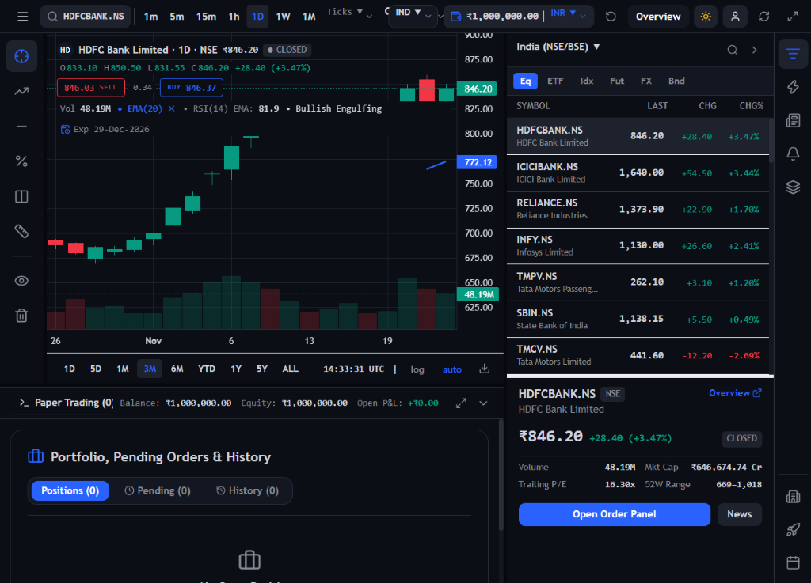
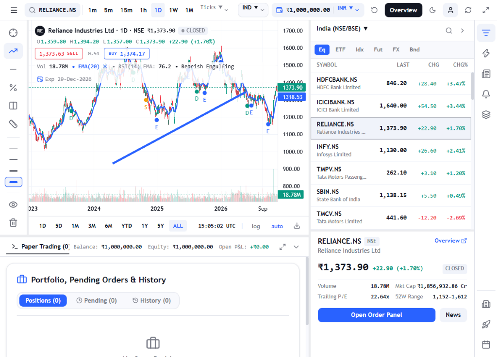
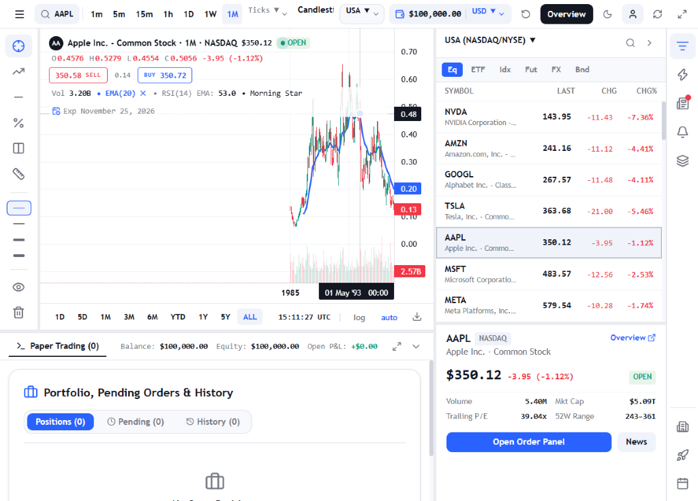
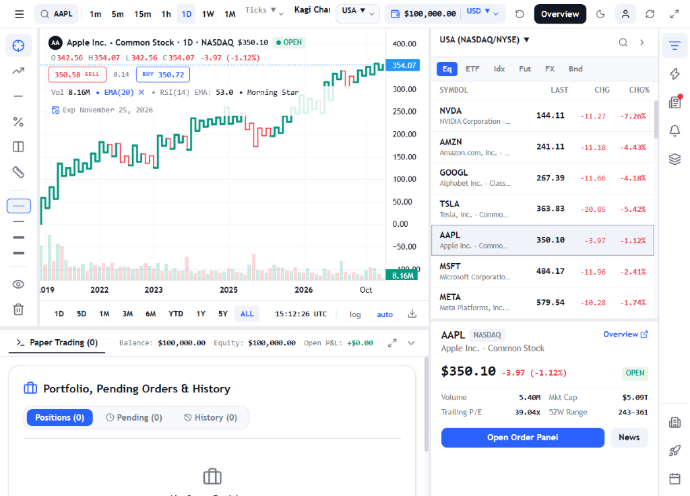
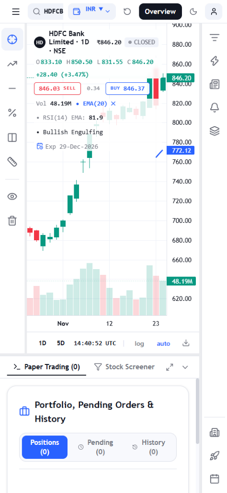
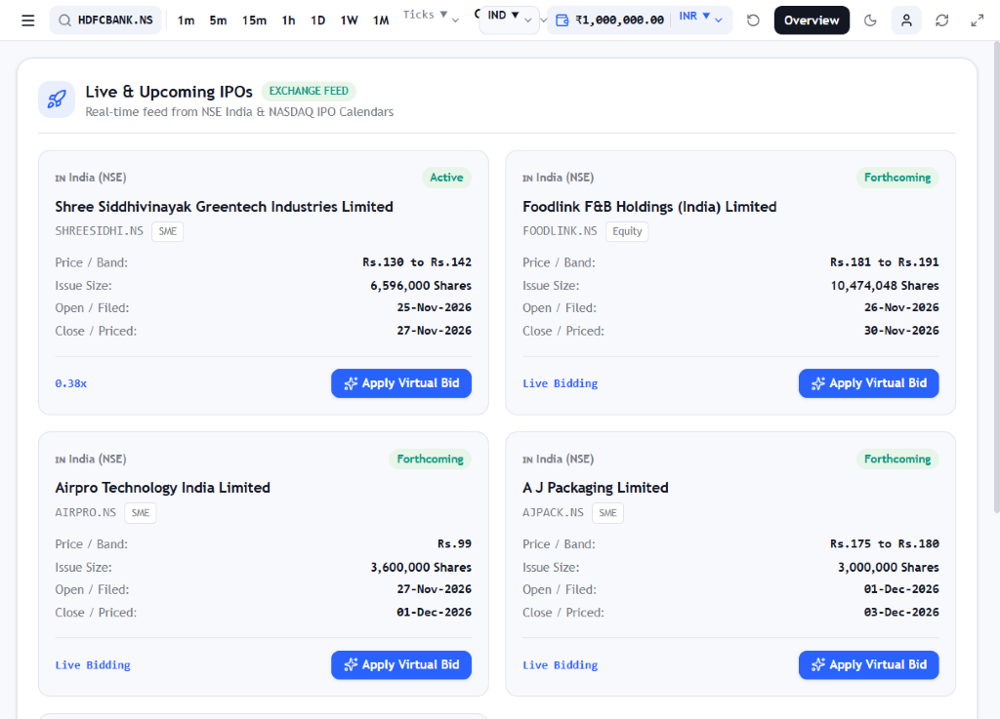

<p align="center">
  
</p>

<h1 align="center">Agam Paper Trading Platform</h1>

<p align="center">
  <strong>100% Free &amp; Open-Source Multi-Tenant Institutional Trading Terminal, 10-Style Superchart &amp; Fundamentals Platform</strong>
</p>

<p align="center">
  
  
  
  
  
  <a href="docs/PROJECT_REPORT.md">
    
  </a>
  <a href="mailto:anirudhjanjirala@gmail.com">
    
  </a>
</p>

<p align="center">
  <strong>Contact Maintainer (Anirudh Janjirala):</strong> <a href="mailto:anirudhjanjirala@gmail.com">anirudhjanjirala@gmail.com</a> &nbsp;|&nbsp; <a href="https://github.com/anirudhjanjirala/Agam-Paper-Trading">GitHub Repository</a> &nbsp;|&nbsp; <a href="docs/PROJECT_REPORT.md"><strong>Full Inspection Report</strong></a>
</p>

---

## Project Description

**Agam Paper Trading Platform** is a full-stack, multi-tenant institutional charting workstation and virtual paper-trading simulator built with **Next.js 16 / React 19 / Lightweight Charts v5** and **FastAPI / SQLAlchemy / Polars**.

It brings together:
- **Zero-cost global market coverage** across **5 regions** (`IND`, `USA`, `CANADA`, `CHINA`, `EU`) with **24,000+ equities, ETFs, indices, futures, FX, and bonds**, powered by asynchronous Google Finance pipelines, public exchange feeds (`period1=0` full listing history), and Google News RSS.
- **Full listing-start historical charts (`ALL` / `max`)**: Load decades of daily/weekly/monthly candles from a company's early listing dates (e.g., `AAPL` from `1980-12-12` — `11,582` daily bars; `RELIANCE.NS` from `1996-01-01` — `7,751` daily bars; `SHOP.TO` from `2015-05-21` — `2,891` daily bars).
- **All 10 TradingView-Grade Chart Types** (plus Baseline): Candlestick, OHLC Bar, Line, Area, Heikin-Ashi, Renko, **Point & Figure (`X` / `O`)**, **Kagi (`Yang` / `Yin`)**, **Three Line Break**, and **Range Bar** charts.
- **Per-Symbol Isolated Line Drawings & `1px`–`4px` Line Weights**: Draw Trend Lines, Horizontal Rays, Parallel Channels, Fibonacci Retracements, and Long/Short Position Rulers with selectable `1px`–`4px` stroke thickness. Drawings are isolated per user and per ticker (`chart:<symbol>`) so annotations never bleed across stocks.
- **Multi-Tenant Paper Trading Isolation**: JWT authentication (HTTP-only cookies + workspace tokens), isolated multi-currency virtual wallets (`INR`, `USD`, `CAD`, `CNY`, `EUR`, `GBP`), partial/full long & short order netting with accurate `realized_pnl`, pending Limit/Stop triggers, non-expiring alerts, and cloud-synced watchlists/layouts.
- **Dual-Theme & Responsive UI**: Zero-flicker Light (`#FFFFFF`) and Dark (`#0B0E14`) themes with SSR-safe hydration (`useSyncExternalStore`) and mobile (`390×844`) overlay drawers.

---

## Screenshots Gallery

### 1. Edge-to-Edge Superchart Terminal (Light Mode)
Full-viewport charting workstation with `52px` (`42px` mobile) drawing dock, `1px`–`4px` line weights, inline `SELL | Spread | BUY` execution chips, 55+ chained indicators, live WebSocket quotes, multi-region Watchlist, and collapsible Paper Trading / Screener / Order Flow / Bar Replay drawer.


### 2. Official Dark Theme (`#0B0E14`)
Instant zero-flicker switch between Official Light and `#0B0E14` Dark themes synced across Tailwind styles, charts, and user account preferences.



### 3. Symbol-Isolated Drawings & `1px`–`4px` Line Weights
Annotations (`Trend Line`, `Horizontal Ray`, `Fib`, `Parallel Channel`, `R:R`) support `1px`–`4px` line weights and stay strictly scoped to each ticker (`RELIANCE.NS` vs `INFY.NS` / `AAPL`).



### 4. Listing-Start Historical Data (`ALL` / `max`)
Default `ALL` mode fetches full daily/monthly exchange history from the stock's listing start (e.g., `AAPL` back to `1980`–`1985`, `RELIANCE.NS` back to `1996`).



### 5. Point & Figure (`X` / `O`) & Kagi (`Yang` / `Yin`) Chart Engines
Custom Lightweight Charts v5 canvas plugins render native zooming/panning Point & Figure `X`/`O` columns and Kagi thick green Yang / thin red Yin stepped lines alongside OHLC Bar, Candlestick, Heikin-Ashi, Renko, Line Break, Range Bar, Line, and Area charts.

| Point & Figure (`X` / `O`) | Kagi (`Yang` / `Yin`) |
| :---: | :---: |
|  |  |

### 6. Mobile Responsive Terminal (`390×844`)
On narrow screens, the watchlist opens as an overlay drawer while the Superchart canvas and scrollable top toolbar remain unobstructed with zero horizontal overflow.



### 7. Symbol Overview, Fundamentals, 16-Chart Workspace & Live IPOs

| Symbol Overview & Financials | 16-Chart Sync Workspace | Live & Upcoming IPOs |
| :---: | :---: | :---: |
|  |  |  |

---

## Key Features & Supported Chart Types

### Supported Chart Types (`10 Requested + Baseline`)
| Value | Label | Renderer / Calculation |
| :--- | :--- | :--- |
| `candles` | Candlestick Chart | Lightweight Charts `CandlestickSeries` |
| `bar` | Bar Chart (OHLC) | Lightweight Charts `BarSeries` |
| `line` | Line Chart | Lightweight Charts `LineSeries` |
| `area` | Area Chart | Lightweight Charts `AreaSeries` |
| `heikin_ashi` | Heikin-Ashi Chart | Smoothed HA OHLC bars via `/api/history` |
| `renko` | Renko Chart | Fixed brick reversal bars with unique ascending timestamps |
| `point_and_figure` | Point & Figure Chart | Custom canvas plugin (`X` rising / `O` falling box columns) |
| `kagi` | Kagi Chart | Custom canvas plugin (thick `#089981` Yang / thin `#F23645` Yin reversals) |
| `line_break` | Line Break Chart | 3-Line Break reversal blocks (`_to_line_break`) |
| `range_bar` | Range Bar Chart | Fixed high-low range bars (`_to_range_bars`) |
| `baseline` | Baseline Chart | Lightweight Charts `BaselineSeries` |

### Platform Capabilities
- **5 Global Markets**: India (`NSE`/`BSE`), USA (`NASDAQ`/`NYSE`/`AMEX`), Canada (`TSX`/`TSXV`), China (`SSE`/`SZSE`), and Europe/UK (`LSE`/`XETRA`/`Euronext`).
- **Multi-Tenant Paper Trading**: Isolated per-user wallets (`INR`, `USD`, `CAD`, `CNY`, `EUR`, `GBP`), Market/Limit/Stop orders, Stop-Loss / Take-Profit automation, long partial-sell `realized_pnl` tracking, and CSV trade/history export.
- **Quant & Screening**: 55+ technical indicators, chained calculations (e.g., `EMA(9) of RSI(14)`), Order Flow (Volume Profile `POC`/`VAH`/`VAL`, TPO Market Profile, Footprint), isolated Bar Replay studio, Polars full-market Screener, and live FRED Macro data.

---

## How to Install & Run

### Prerequisites
- **Python 3.11+** (`python --version`)
- **Node.js 20+** & **npm** (`node -v`, `npm -v`)

### 1. Clone & Install Dependencies
```bash
git clone https://github.com/anirudhjanjirala/Agam-Paper-Trading.git
cd "Agam-Paper-Trading"

# Backend dependencies
cd backend
pip install -r requirements.txt
cd ..

# Frontend dependencies
cd frontend
npm install
cd ..
```

### 2. Configure Local Frontend Environment
Create `frontend/.env.local` (gitignored) for 100% local execution:
```env
NEXT_PUBLIC_API_URL=http://localhost:8000
NEXT_PUBLIC_WS_URL=ws://localhost:8000
```
*(In local development, `backend/core/auth.py` automatically generates a per-machine `.agam_jwt_secret` outside Git tracking and uses local SQLite `backend/agam_portfolio.db`.)*

### 3. Run Locally (Recommended Single-Terminal Launcher)

- **Windows 1-Click**: Double-click **`start_all.bat`**.
- **Dev Mode (Backend `--reload` + Next.js Dev Server)**:
  ```bash
  python start_agam.py
  ```
- **Production Mode (Fastest Compiled UI)**:
  ```bash
  cd frontend
  npm run build
  cd ..
  python start_agam.py --prod
  ```
- **Headless / Background Flag**: Pass `--no-browser` (`python start_agam.py --prod --no-browser`) to skip auto-opening the browser tab. Press **`Ctrl+C`** once to stop both servers cleanly.

### 4. Manual Two-Terminal Run (Optional)
```bash
# Terminal 1 — FastAPI Backend (http://127.0.0.1:8000)
cd backend
python -m uvicorn main:app --host 127.0.0.1 --port 8000 --reload

# Terminal 2 — Next.js Frontend (http://localhost:3000)
cd frontend
npm run dev
```

### 5. Production Stack (PostgreSQL + Redis + Docker Compose)
Copy `.env.production.example` to `.env.production`, set strong non-default values (`JWT_SECRET` >= 32 chars, `POSTGRES_PASSWORD`, explicit `CORS_ORIGINS`), and run:
```bash
docker compose -f docker-compose.prod.yml --env-file .env.production up --build -d
```

---

## What Changed Every Time (Release Summary)

Full technical details and affected files are documented in **[CHANGELOG.md](CHANGELOG.md)**.

| Release / Commit | Focus | Key Changes |
| :--- | :--- | :--- |
| **`v1.0.0`** (`87b170c`) | **Initial Open-Source Platform** | FastAPI backend, zero-cost Google Finance + News RSS engines, 5-market Polars universe, 55+ chained indicators, Bar Replay, Tick Aggregator, Alerts, MIT license, `start_agam.py`, and zero third-party chart logos (`attributionLogo: false`). |
| **`v2.0.0`** (`d70306d`) | **Multi-Tenancy & Dual Theme** | PostgreSQL/SQLite SQLAlchemy multi-tenant isolation (`auth.py`, `models.py`, `tenant_store.py`, `ws_hub.py`), JWT cookie auth, full Next.js 16 / React 19 UI tree, Light/Dark (`#0B0E14`) Theme Engine, and Docker/Nginx deployment manifests. |
| **`v3.0.0`** (`Latest`) | **Chart Parity, History, Drawings & Hardening** | **10 chart types** (`Bar`, `Line`, `Candlestick`, `Heikin-Ashi`, `Renko`, custom `Point & Figure`, `Area`, custom `Kagi`, `Line Break`, `Range Bar`); **per-symbol isolated drawings + `1px`–`4px` line weights**; **full listing-start `period1=0` historical data (`ALL`/`max`)**; punctuated ticker search fix; React `#418` hydration fix; `390×844` mobile drawer & header fix; empty IPO retry state; strict `JWT_SECRET`, CORS, Docker password, long partial-sell `realized_pnl`, and NumPy RSI divide-by-zero fixes. |

---

## Project Structure

```text
Agam Paper Trading/
├── start_agam.py              # Single-terminal launcher (--prod, --no-browser)
├── start_all.bat              # Windows 1-click launcher
├── CHANGELOG.md               # Detailed chronological change log
├── docker-compose.prod.yml    # PostgreSQL + Redis + FastAPI + Next.js + Nginx stack
├── docs/PROJECT_REPORT.md     # Full architecture, audit & code inspection report
├── docs/screenshots/          # Verified terminal, chart style & mobile screenshots
├── backend/
│   ├── main.py                # FastAPI REST + WebSocket engine & OHLC/custom transforms
│   ├── requirements.txt       # Python dependencies
│   ├── core/                  # Auth, multi-tenant SQLAlchemy store, quant, replay, alerts, screener
│   ├── migrations/            # PostgreSQL schema migrations
│   └── engine/                # Async Google Finance (period1=0 max history) & Google News RSS
└── frontend/
    ├── public/agam-logo.svg   # Custom Agam brand mark
    └── src/
        ├── app/               # Next.js App Router pages, layout & ThemeProvider
        ├── components/        # TradingViewChart, chartSeriesPlugins (Kagi/PnF), Overview, MultiChart, Screener
        ├── lib/               # API/WS URL cleaner, token storage, currency/number formatters
        └── workers/           # Web Worker for 60 FPS multi-chart indicator calculations
```

---

## Contact

For questions, feedback, collaborations, or bug reports, reach out directly:

- **Maintainer:** Anirudh Janjirala
- **Email:** [anirudhjanjirala@gmail.com](mailto:anirudhjanjirala@gmail.com)
- **GitHub:** [anirudhjanjirala/Agam-Paper-Trading](https://github.com/anirudhjanjirala/Agam-Paper-Trading)

### Contributors
- **Sai Raju** (Basani Sai Raju)
- **Manoj**
- **Lavan Kumar**

---

## License

This project is open source and available under the **[MIT License](LICENSE)**.
