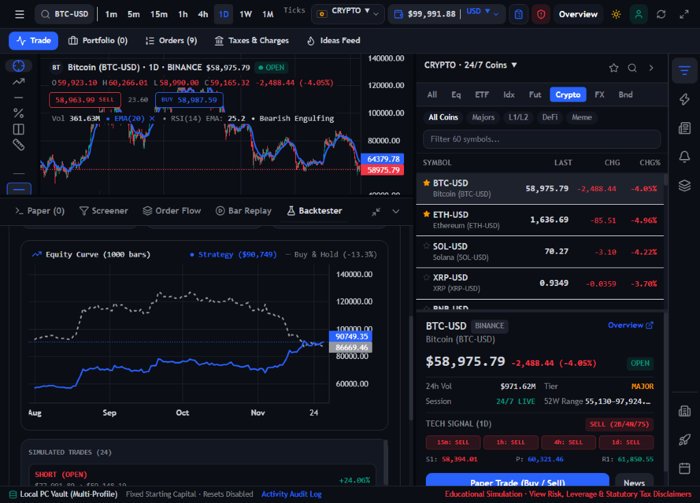
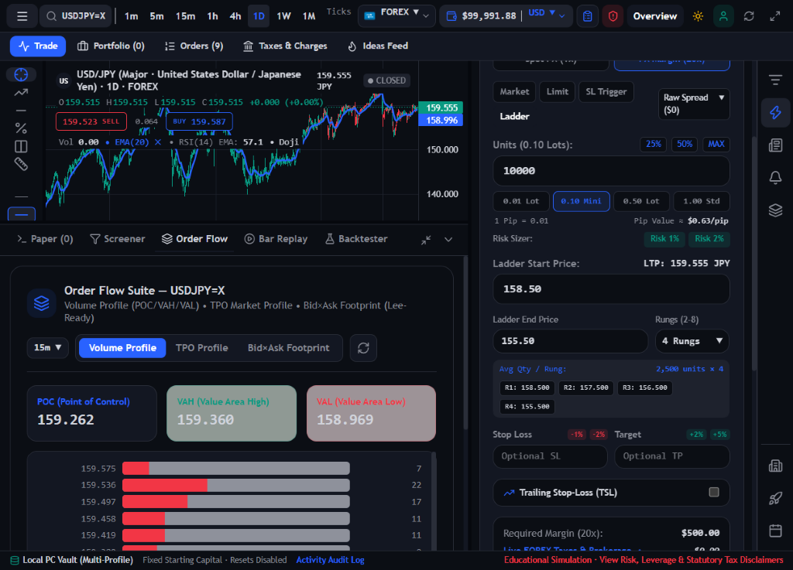
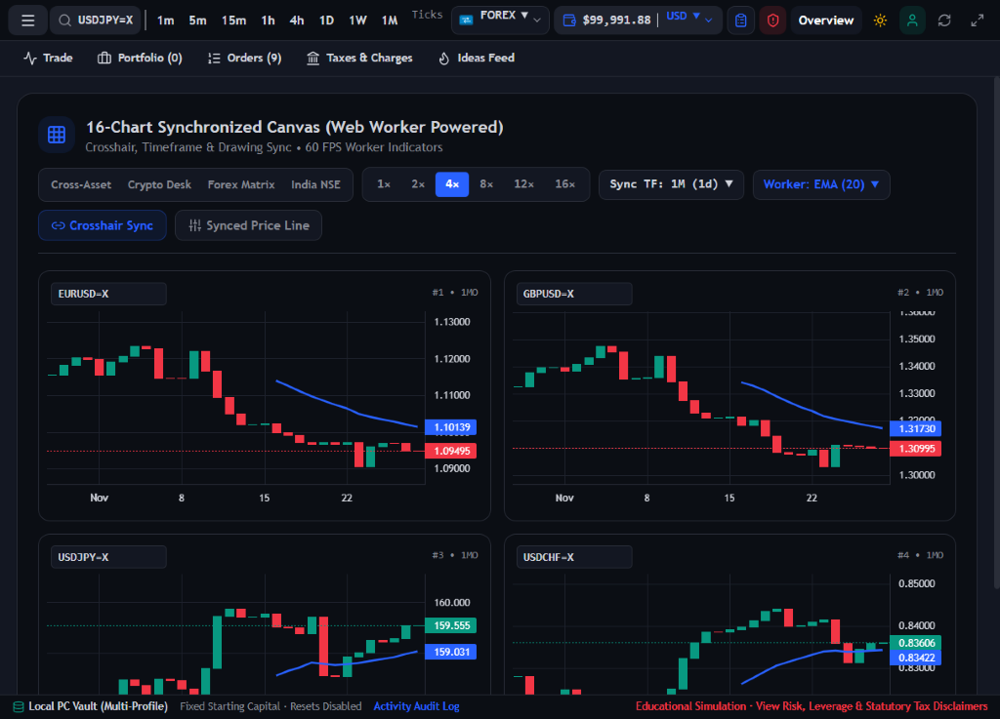
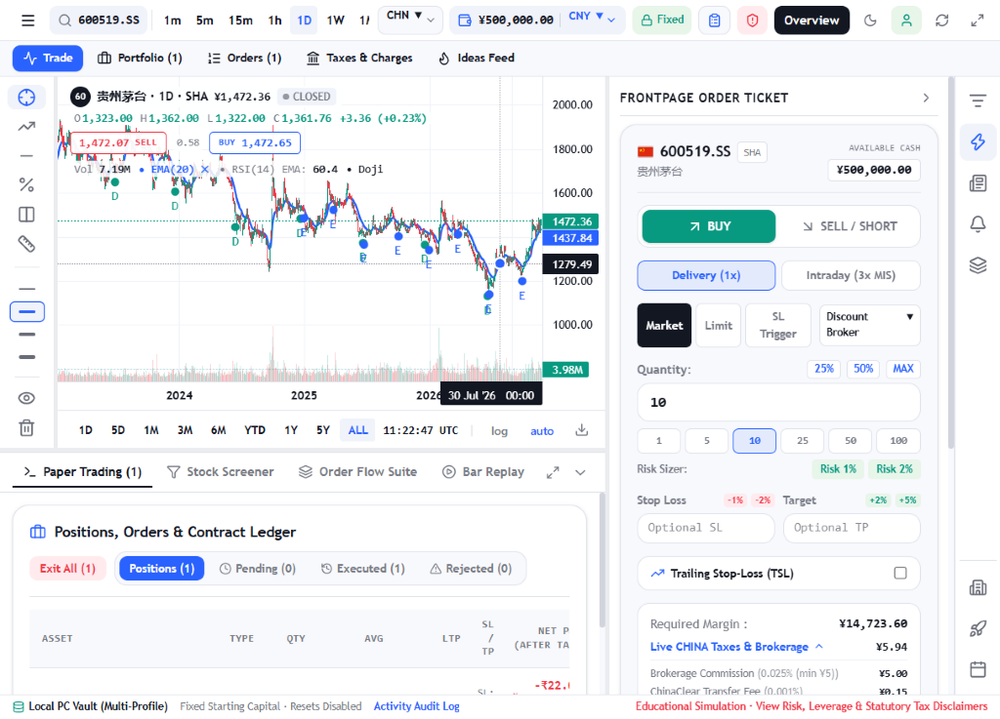
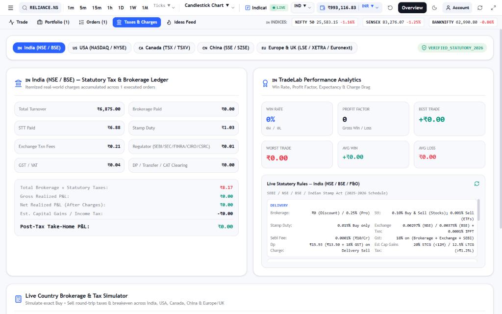
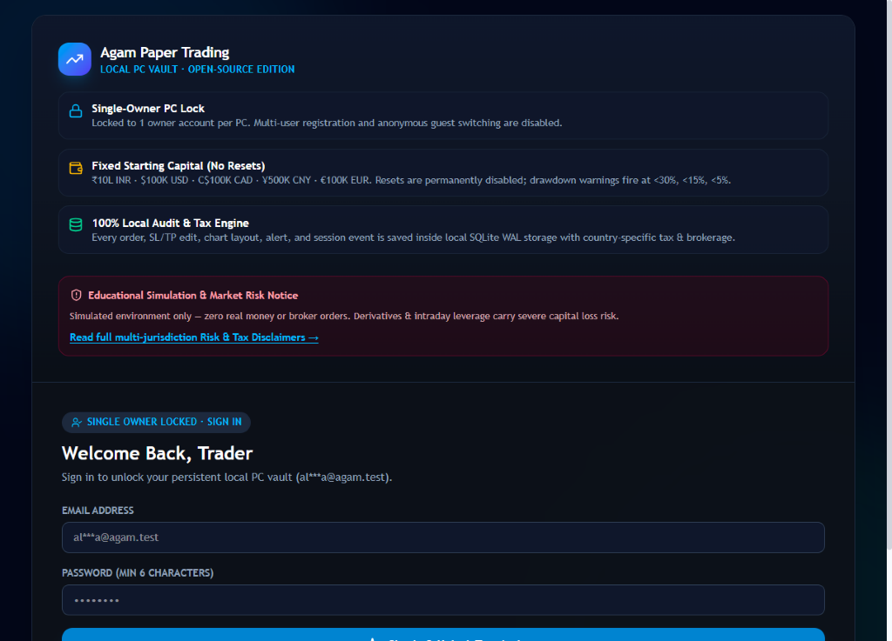

<p align="center">
  
</p>

<h1 align="center">Agam Paper Trading Platform</h1>

<p align="center">
  <strong>100% Free &amp; Open-Source Local PC Institutional Multi-Asset Paper Trading Terminal — Equities, 24/7 Crypto, Global Forex, Strategy Backtester &amp; Live Asset-Class Tax Engine</strong>
</p>

<p align="center">
  
  
  
  
  
  
  
  <a href="mailto:anirudhjanjirala@gmail.com">
    
  </a>
</p>

<p align="center">
  <strong>Maintainer:</strong> Anirudh Janjirala (<a href="mailto:anirudhjanjirala@gmail.com">anirudhjanjirala@gmail.com</a>) &nbsp;|&nbsp;
  <strong>Repository:</strong> <a href="https://github.com/anirudhjanjirala/Agam-Paper-Trading">GitHub</a> &nbsp;|&nbsp;
  <strong>License:</strong> MIT Open Source
</p>

---

## 🌟 Quick Overview: What is Agam?

**Agam Paper Trading Platform** is a zero-cost, open-source, institutional-grade trading terminal that runs completely on your own PC without paid API keys (`$0`/month).

Unlike toy paper-trading apps with instant "Reset Balance" buttons and zero transaction friction, Agam enforces **real-world trading discipline**:
- **7 Complete Asset Markets (`40,808` Instruments)**: Trade Stocks, ETFs, Indices, Bonds, Commodities, **24/7 Cryptocurrencies**, and **Global Forex Pairs** across India, USA, Canada, China, Europe/UK, Crypto, and FX.
- **Fixed, Non-Resettable Capital per Profile**: Multiple local traders share one computer with isolated SQLite-backed vaults, multi-currency wallets, and drawdown discipline (`<30%`, `<15%`, `<5%` warnings).
- **Asset-Class Tax & Fee Accuracy**: Simulates STT, Stamp Duty, SEBI, CTT, SEC Section 31, FINRA TAF, UK SDRT, French/Italian/Belgian FTT, China Stamp Tax, Crypto Spot/Perp Maker-Taker fees, and ECN Forex commissions.
- **Institutional Quant Workbench**: Includes a **Vectorized Strategy Backtester Lab**, **Multi-Timeframe Technical Scorecard & Pivot Levels**, **Order Flow Suite (POC/TPO/Footprint)**, **Bar Replay Studio (Long/Short + Fractional)**, **Scaled Limit Ladders**, **Atomic `Flip` & `50%` Trim**, **Risk & Exposure Analytics Desk**, and **16-Chart Synchronized Canvases**.

---

## 📸 Visual Showcase & Screenshots

### 1. 24/7 Crypto Desk, Strategy Backtester Lab & Multi-Timeframe Scorecard (`#0B0E14` Dark Mode)
Trade 24/7 Crypto pairs (`BTC-USD`, `ETH-USD`, micro-cap coins up to 8 decimals), inspect **MTF Consensus (`15m / 1h / 4h / 1d`)** and **Pivot Levels (`S1 / P / R1`)** directly in the Watchlist Details panel, and run vectorized backtests comparing your strategy against Buy & Hold (`Supertrend`, `EMA Cross`, `RSI Reversion`, `MACD Momentum`, `Bollinger Breakout`).



---

### 2. Global Forex Desk, Scaled Limit Ladder & Order Flow Suite (`USDJPY=X`)
Trade G10 Majors, Crosses, Exotics, and INR FX pairs with `20x` margin, Lot/Pip analytics (`1 Pip`, `Pip Value $/pip`), clean native quote display (`159.555 JPY`), **Scaled Limit Ladder** orders (`2–8` staggered `R1..Rn` rungs), and **Order Flow Suite** (Volume Profile `POC / VAH / VAL`, TPO, Bid×Ask Footprint across `5m–1d`).



---

### 3. 16-Chart Synchronized Workspace (`Forex Matrix` & `Crypto Desk` Presets)
Switch instantly across 1x–16x synchronized tiles powered by Web Workers (`EMA(20)`, Crosshair Sync, Synced Price Lines) with one-click **`Cross-Asset`**, **`Crypto Desk`**, **`Forex Matrix`**, and **`India NSE`** desk layouts.



---

### 4. Multi-Profile PC Vault (Switch, Add, or Remove Traders)
Manage multiple separate trader accounts on the same computer. Switch seamlessly between profiles or onboard new traders without overwriting anyone else's positions or audit logs.



---

### 5. Live Statutory Tax Center, Interactive Order Execution & Portfolio Analytics
Preview exact statutory taxes, brokerage, break-even delta, and required margin before clicking Buy/Sell, then monitor portfolio-wide equity (USD), Margin Utilization %, Portfolio Heat %, Profit Factor, and Expectancy.

| Live Statutory Tax & Fee Simulator | Interactive Execution Ticket |
| :---: | :---: |
|  |  |

| Edge-to-Edge Light / Dark Terminal | Vault Onboarding & Disclaimer |
| :---: | :---: |
|  |  |

---

### 6. All 10+ TradingView-Grade Chart Styles & Isolated Per-Symbol Drawings
Powered by Lightweight Charts v5 plus custom HTML5 `ICustomSeriesPaneView` renderers (`Kagi` & `Point & Figure`) and symbol-isolated drawing persistence (`1px`–`4px` stroke weights):

| Point & Figure (`X` / `O`) | Kagi (`Yang` / `Yin`) | Drawings & Line Weights |
| :---: | :---: | :---: |
|  |  |  |

---

## ⚡ Complete Feature Breakdown

### 🌐 1. Global 40,808+ Instrument Universe Across 7 Markets
Fast Polars Arrow-backed scanner (`<50ms` warm-start boot & sub-second columnar scans):
- **USA (`12,937`)**: NASDAQ, NYSE, AMEX Equities, ETFs, US Treasuries & CME Commodities.
- **India (`8,962`)**: NSE & BSE Equities, Nifty/Sensex Indices, MCX Commodities, Sovereign Bonds & ETFs.
- **China (`7,553`)**: Shanghai (`SSE`) & Shenzhen (`SZSE`) Stocks, ETFs & Indices.
- **Europe & UK (`6,481`)**: London (`LSE`), Frankfurt (`XETRA`), Euronext Paris & Brussels, Borsa Italiana, SIX Swiss.
- **Canada (`3,786`)**: `TSX` & `TSXV` Equities, Commodities & ETFs.
- **Crypto (`1,023` — `24/7 LIVE`)**: Bitcoin, Ethereum, Solana, Layer-1/L2s, DeFi, & Micro-Cap tokens (`-USD` / `-EUR` / `-USDT`) with continuous `24/7` trading and fractional sizing (`0.00001+` units).
- **Forex (`66` — `24/5` G10 & Crosses)**: G10 Majors (`EURUSD=X`, `USDJPY=X`, `GBPUSD=X`, `USDCHF=X`, `USDCAD=X`, `AUDUSD=X`, `NZDUSD=X`), Crosses, Exotics, `DX-Y.NYB` Dollar Index, plus INR FX pairs indexed in India (`USDINR=X`).

### 🧪 2. Institutional Quant, Strategy & Risk Tools
- **Vectorized Strategy Backtester Lab**: Evaluate **EMA Cross (12/26)**, **Supertrend (10, 3.0)**, **RSI Reversion (14)**, **MACD Momentum**, and **Bollinger Band Breakout** over any ticker (`15m`, `1h`, `4h`, `1D`, up to `2Y`) with Equity vs. Buy & Hold curve, Sharpe Ratio, Max Drawdown %, Win Rate, Profit Factor, configurable slippage/fee bps, Long+Short toggle, and Simulated Trade Ledger.
- **Multi-Timeframe Technical Signal Scorecard & Pivots**: Combines `15m / 1h / 4h / 1d` directional ratings (`STRONG BUY` to `STRONG SELL`), BUY/NEUTRAL/SELL oscillator/MA vote breakdown, Classic & Fibonacci Pivots (`S1 / P / R1`), and ATR volatility right inside the Watchlist Details drawer.
- **Scaled Limit Ladder & Risk Sizing**: Split limit entries across `2–8` staggered price rungs (`[Start Price -> End Price]`) with live `R1..Rn` badge previews, plus 1-click **Risk 1% / Risk 2%** dynamic position sizing based on stop-loss distance.
- **Atomic One-Click `Flip` (`Reverse`) & `50%` Trim**: Immediately close half a position (`50%` Trim, supporting fractional Crypto/FX down to `0.00002` units) or reverse Long <-> Short at market in a single atomic transaction.
- **Institutional Risk & Exposure Portfolio Matrix**: Tracks cross-wallet **Global Equity (USD)**, **Margin Utilization %**, **Portfolio Heat % (Distance to Stop-Loss)**, **Long/Short/Net Exposure**, **Profit Factor**, **Payoff Ratio**, **Expectancy ($/Trade)**, and **Max Drawdown %**.
- **Bar Replay Studio & Order Flow Suite**: Step bar-by-bar (`+1` / `+5` / Auto-Play), trade **Long & Short** with fractional sizing and live Return %, Win Rate %, and Max Drawdown % metrics; inspect **Volume Profile (`POC / VAH / VAL`)**, **TPO Market Profile**, and **Lee-Ready Bid×Ask Footprint (`5m–1d`)**.
- **Chart PNG Snapshot & Hotkeys**: Capture PNG screenshots directly from the chart toolbar, toggle between Light & `#0B0E14` Dark Mode, and use keyboard trading shortcuts (`Alt+B` Buy / `Alt+S` Sell).

### 🏛️ 3. Real-World Live Tax & Regulatory Cost Engine
- **India (IND)**: STT (`0.1%` delivery, `0.025%` intraday sell), Stamp Duty (`0.015%` buy), MCX CTT (`0.01%`), SEBI turnover fee, `18%` GST on brokerage.
- **USA**: SEC Section 31 fee (`$0.0000278` sells), FINRA TAF (`$0.000166/share`).
- **UK & Europe (EU)**: UK LSE `0.5%` SDRT, France `0.4%` FTT, Italy `0.1%` Tobin Tax, Belgium `0.35%` TOB, Germany XETRA `0%` FTT (`0%` EU/UK FTT on Forex).
- **China**: `0.05%` Stamp Tax on stock sells (`0%` ETFs), ChinaClear & CSRC fees.
- **Crypto (`24/7`)**: Spot (`0.10%` Taker / `0.04%` VIP Maker) and Perp/Margin (`0.05%` Taker / `0.02%` Maker) fee schedules + local VDA gains references.
- **Forex (`24/5`, `20x` Margin)**: Raw Spread (`$0.00` commission) or ECN Institutional (`$3.50 / $100k` lot, min `$0.35`) with automated FX quote-to-settlement USD conversion (`compute_fx_quote_to_settle`).

### 📈 4. 10+ Charting Styles & Technical Suite
Candlestick · OHLC Bar · Line · Area · Heikin-Ashi · Renko · Point & Figure (`X`/`O`) · Kagi (`Yang`/`Yin`) · Three Line Break · Range Bar · Baseline — paired with 55+ overlays/oscillators, candlestick pattern detection, and symbol-isolated drawing tools (`1px–4px`).

---

## 🚀 Getting Started (Run Locally in 3 Minutes)

### 📋 Prerequisites
- **Python 3.11+** ([python.org](https://www.python.org/downloads/))
- **Node.js 20+** ([nodejs.org](https://nodejs.org/))
- **Git** ([git-scm.com](https://git-scm.com/))

### Step 1: Clone & Install
```bash
git clone https://github.com/anirudhjanjirala/Agam-Paper-Trading.git
cd "Agam-Paper-Trading"

# Backend dependencies
cd backend
pip install -r requirements.txt
cd ..

# Frontend dependencies
cd frontend
npm install
cd ..
```

### Step 2: Launch the Platform
- **Windows 1-Click**: Double-click `start_all.bat`
- **Unified Python Launcher (Dev Mode)**:
  ```bash
  python start_agam.py
  ```
- **Production Compiled Mode (Recommended for Fastest Speed)**:
  ```bash
  cd frontend && npm run build && cd ..
  python start_agam.py --prod
  ```
Open `http://localhost:3000` (FastAPI backend runs on `http://127.0.0.1:8000`).

### Step 3: Run the Automated Backend Verification Suite
```bash
cd backend
python tests/test_taxes_and_frontpage.py
```

---

## 📂 Project Architecture

```text
Agam Paper Trading/
├── start_agam.py                        # Cross-platform unified launcher
├── start_all.bat                        # Windows 1-click startup script
├── README.md                            # Complete platform documentation
├── CHANGELOG.md                         # Release history (v1.0.0 -> v4.0.0)
├── CONTRIBUTING.md                      # Open-source contribution guidelines
├── LICENSE                              # MIT License
├── docker-compose.prod.yml              # Production multi-service stack
├── docs/
│   ├── PROJECT_REPORT.md                # Full architecture & audit report
│   └── screenshots/                     # UI & feature showcase screenshots
├── backend/
│   ├── main.py                          # FastAPI REST & WebSocket gateway (backtest, ladder, flip, risk, charts)
│   ├── requirements.txt                 # Python dependencies
│   ├── tests/
│   │   └── test_taxes_and_frontpage.py  # Isolated end-to-end tax, Crypto/FX & institutional QA tests
│   ├── core/
│   │   ├── auth.py                      # Multi-profile vault, PBKDF2 auth & HTTP-only JWT cookies
│   │   ├── database.py                  # SQLAlchemy SQLite WAL / PostgreSQL engine
│   │   ├── models.py                    # Multi-tenant ORM schemas
│   │   ├── paper_wallets.py             # Multi-currency vault defaults & helpers
│   │   ├── tax_brokerage.py             # Country & asset-class statutory taxes + FX settlement scaling
│   │   ├── tenant_store.py              # Isolated portfolio CRUD, Ladder/Flip orders & Risk Analytics
│   │   ├── universe_loader.py           # 40,800+ instrument loader across 7 markets (Polars)
│   │   ├── screener_engine.py           # Vectorized multi-factor columnar scanner
│   │   ├── quant_engine.py              # Indicators, Volume/TPO/Footprint, MTF Scorecard & Strategy Backtester
│   │   ├── replay_engine.py             # Bar-by-bar replay simulator (Long/Short + fractional qty)
│   │   ├── tick_aggregator.py           # Real-time fractional tick/bar aggregator
│   │   ├── alert_engine.py              # Price & indicator threshold alert engine
│   │   ├── fundamentals.py              # Company financials & earnings parser
│   │   └── ws_hub.py                    # WebSocket broadcast manager
│   └── engine/
│       ├── google_finance.py            # Live quotes, multi-market history & FX/Crypto feeds
│       └── google_news.py               # Regional & asset-aware RSS market news parser
└── frontend/
    ├── src/
    │   ├── app/
    │   │   ├── page.tsx                 # Main workstation shell, chart state & hotkeys
    │   │   ├── layout.tsx               # App Router root metadata
    │   │   └── globals.css              # Light & #0B0E14 Dark Mode styles
    │   ├── workers/
    │   │   └── quantWorker.ts           # Background Web Worker for 60 FPS indicator math
    │   ├── lib/
    │   │   ├── api.ts                   # Fetch client & URL builder
    │   │   └── format.ts                # Adaptive precision, Crypto & FX currency formatters
    │   ├── types/
    │   │   └── trading.ts               # Shared TypeScript trading interfaces
    │   └── components/
    │       ├── BacktestLab.tsx          # Vectorized Strategy Backtester & Equity Curve chart
    │       ├── TradingViewChart.tsx     # Lightweight Charts v5 canvas, drawings & PNG snapshot
    │       ├── MultiChartWorkspace.tsx  # 16-Chart synced canvas with Crypto/Forex presets
    │       ├── OrderFlowSuite.tsx       # Volume Profile, TPO & BidxAsk Footprint UI
    │       ├── BarReplayPanel.tsx       # Bar Replay Studio with Short/Long & performance stats
    │       ├── OrderDrawer.tsx          # Market/Limit/SL/Ladder ticket, Pip Value & Risk Sizer
    │       ├── PositionsTable.tsx       # Positions, Pending (cancel-safe), Executed & Flip/50% Trim
    │       ├── ScreenerPanel.tsx        # 40,800+ asset multi-market scanner UI
    │       ├── AlertManager.tsx         # Alert rules manager
    │       ├── AuthGate.tsx             # Local PC multi-profile switcher
    │       ├── CountryFlag.tsx          # Cross-platform inline SVG market/currency flags
    │       ├── tv/
    │       │   ├── BottomTerminalDrawer.tsx # Paper, Screener, Order Flow, Replay & Backtester tabs
    │       │   └── RightSidebar.tsx     # Watchlist (7 markets), Technical Signal Scorecard & tools
    │       └── frontpage/
    │           ├── FrontPageTaxCenter.tsx  # Statutory tax & brokerage simulator
    │           ├── FrontPagePortfolio.tsx  # Institutional Risk Matrix & asset positions
    │           ├── FrontPageOrders.tsx     # Order book & execution ledger
    │           └── FrontPageFeed.tsx       # Live trade ideas & social stream
    └── public/
        └── agam-logo.svg                # Official Agam brand SVG
```

---

## 🔒 Security & Privacy Notice

- **100% Local & Private**: Credentials, wallet balances, orders, positions, watchlists, and audit logs remain on your machine inside `backend/agam_platform.db` (SQLite WAL).
- **No Tracking or Paid APIs**: Zero telemetry and zero paid external data subscriptions required.

---

## ⚠️ Educational Disclaimer

> **IMPORTANT**: Agam Paper Trading Platform is an educational simulation tool designed to help traders practice risk management, strategy testing, and statutory cost awareness. It does **not** process real money, does **not** route live exchange orders, and does **not** constitute financial or investment advice.

---

## 👥 Contributors & Contact

- **Lead Architect & Maintainer:** Anirudh Janjirala ([anirudhjanjirala@gmail.com](mailto:anirudhjanjirala@gmail.com))
- **GitHub:** [@anirudhjanjirala](https://github.com/anirudhjanjirala)
- **Contributors:** Sai Raju, Manoj, Lavan Kumar

---

## 📄 License

This project is open source under the **MIT License** — see [LICENSE](LICENSE) and [CONTRIBUTING.md](CONTRIBUTING.md) to fork, study, customize, and contribute!
