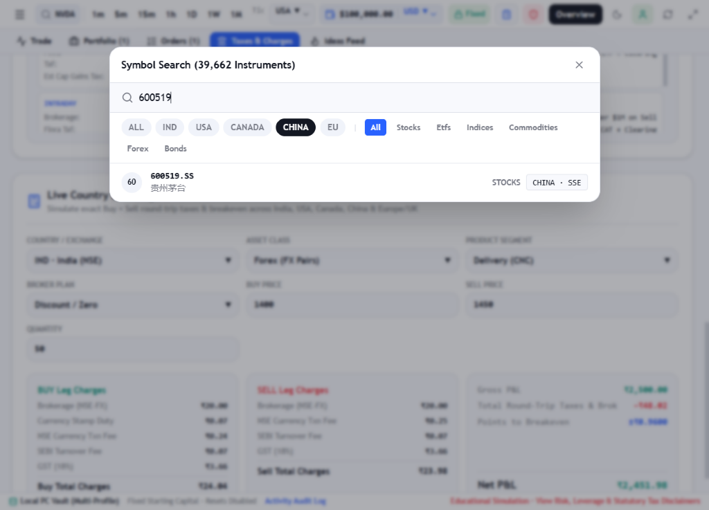
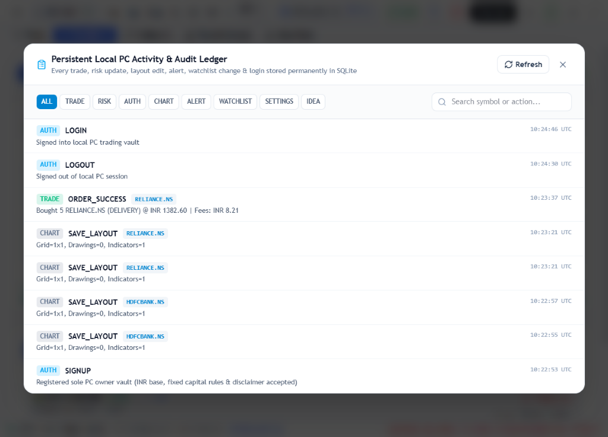
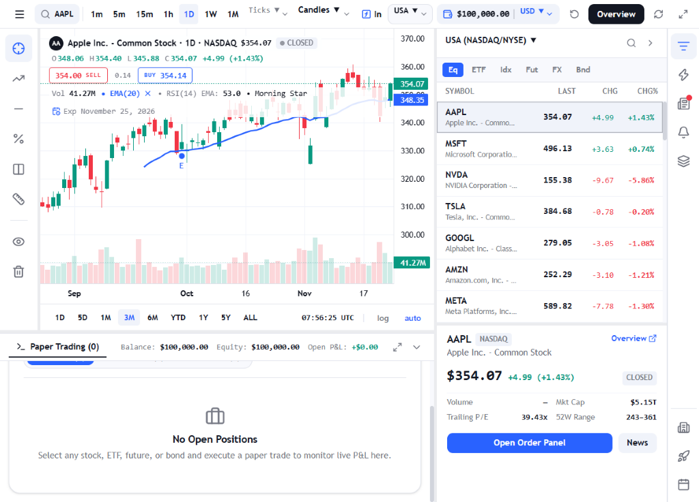
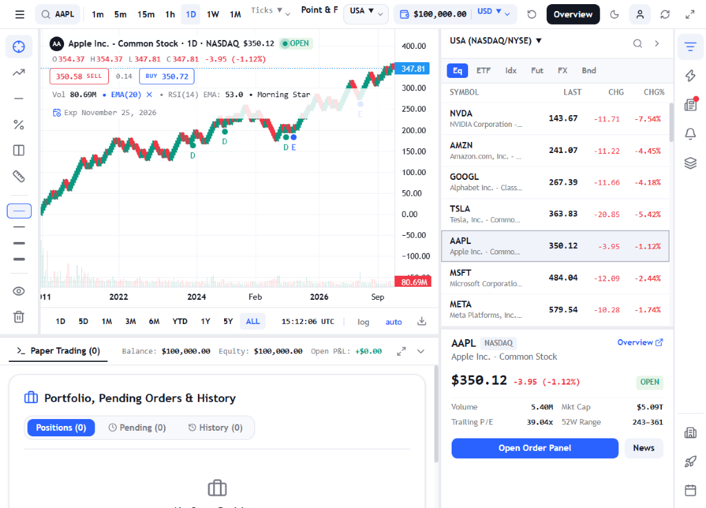

<p align="center">
  
</p>

<h1 align="center">Agam Paper Trading Platform</h1>

<p align="center">
  <strong>100% Free &amp; Open-Source Local PC Institutional Paper Trading Terminal, 10-Style Superchart, Multi-Profile Vault &amp; Live Asset-Class Tax Engine</strong>
</p>

<p align="center">
  
  
  
  
  
  
  <a href="mailto:anirudhjanjirala@gmail.com">
    
  </a>
</p>

<p align="center">
  <strong>Maintainer:</strong> Anirudh Janjirala (<a href="mailto:anirudhjanjirala@gmail.com">anirudhjanjirala@gmail.com</a>) &nbsp;|&nbsp;
  <strong>Repository:</strong> <a href="https://github.com/anirudhjanjirala/Agam-Paper-Trading">GitHub</a> &nbsp;|&nbsp;
  <strong>License:</strong> MIT Open Source
</p>

---

## 🌟 Quick Overview: What is Agam?

**Agam Paper Trading Platform** is an institutional-grade, zero-cost paper trading workstation built for traders, quantitative learners, and enthusiasts. It runs entirely on your local PC with zero paid external API dependencies. 

Unlike conventional mock trading websites that reset without consequences, Agam introduces **strict trading psychology discipline**:
- **Fixed, non-resettable capital** per profile (no easy "Reset to \$100k" button when you lose money).
- **Progressive risk and drawdown warnings** (`<30%`, `<15%`, `<5%`).
- **Real-world statutory taxes & brokerage** tailored to each country and asset class (STT, Stamp Duty, CTT, SEC, FINRA, SDRT, FTT, TOB).
- **Multi-Profile Vault** on one PC: multiple traders, friends, or family members can have their own isolated accounts, currency wallets, and audit trails on the same machine.
- **Global 39,700+ instruments** across India, USA, Canada, China, and Europe with zero lag.

---

## 📸 Visual Showcase & Screenshots

### 1. Multi-Profile PC Vault (Switch, Add, or Remove Traders)
Manage multiple separate trader vaults on the same computer. Switch between accounts seamlessly or add new traders anytime without deleting previous data. All deletions are protected by password verification.


---

### 2. Edge-to-Edge Superchart & FrontPage Terminal
Full-screen institutional trading terminal equipped with real-time watchlist, instant order execution drawer, portfolio metrics, live orders, and 55+ technical indicators.


---

### 3. Live Statutory Tax & Brokerage Center (Asset-Class Aware)
Inspect exact estimated taxes, brokerages, exchange fees, and statutory levies in real time before placing a trade. Supports **Stocks, ETFs, Commodities, Forex, and Bonds** across IND, USA, Canada, China, and EU.



---

### 4. Interactive Order Execution Drawer
Execute `DELIVERY` (1x Cash) or `INTRADAY` (up to 5x margin) trades with real-time fee previews, automatic Stop-Loss, Take-Profit, and Trailing Stop automation.



---

### 5. Secure First-Time Vault Registration & Disclaimer
Clean, beginner-friendly onboarding with instant starting capital allotment in your chosen base currency and regulatory risk disclaimers.


---

### 6. Dual Theme Support: Official Light & `#0B0E14` Dark Mode
Instant zero-flicker toggle between clean institutional light mode and deep `#0B0E14` dark theme.

| Dark Theme (`#0B0E14`) | Edge-to-Edge Superchart |
| :---: | :---: |
|  |  |

---

### 7. All 10 TradingView-Grade Chart Types
Built on custom Lightweight Charts v5 canvas renderers supporting exotic brick and column representations:

| Point & Figure (`X` / `O`) | Kagi (`Yang` / `Yin`) | Drawings & Line Weights |
| :---: | :---: | :---: |
|  |  |  |

---

## ⚡ Core Features & Highlights

### 1. 🛡️ Multi-Profile Local PC Vault
- **Multi-Trader Architecture**: Perfect for personal computers used by multiple traders.
- **Isolated Wallets**: Each user has an independent balance, open positions, order book, and activity log.
- **Account Protection**: Switching profiles or removing an account requires password verification.
- **Capital Discipline**: Starting balance is non-resettable. Low-margin warnings trigger when funds drop below 30%, 15%, and 5%.

### 2. 🏛️ Real-World Live Tax & Regulatory Cost Engine
Accurately models actual statutory deductions so your paper trading results match real-world net profits:
- **India (IND)**: 
  - Stocks: STT (0.1% delivery, 0.025% intraday sell), Stamp Duty (0.015% buy), SEBI turnover fee, GST (18% on brokerage).
  - Commodities (MCX): CTT (0.01% on non-agri futures), Stamp Duty (0.003%), Commodity transaction charges.
  - ETFs & Bonds: Exempted from commodity CTT.
- **United States (USA)**:
  - SEC Section 31 transaction fee ($0.0000278 on sells), FINRA Trading Activity Fee (TAF, $0.000166/share), standard zero-commission paper models.
- **United Kingdom & Europe (EU)**:
  - UK LSE (`.L`): 0.5% Stamp Duty Reserve Tax (SDRT) on buys.
  - France Euronext (`.PA`): 0.4% Financial Transaction Tax (FTT).
  - Italy Borsa Italiana (`.MI`): 0.1% Tobin Tax.
  - Belgium Euronext (`.BR`): 0.35% Tax on Stock Exchange Transactions (TOB).
  - Germany XETRA (`.DE`): 0% statutory FTT.
- **China (SSE/SZSE)**:
  - 0.05% Ministry of Finance Stamp Tax on stock sales (0% on ETFs).

### 3. 🌐 Global 39,700+ Instrument Universe
Instant warm-boot universe loader powered by asynchronous multi-exchange pipelines (<50ms query latency):
- **India**: 8,900+ NSE & BSE equities, indices, and MCX commodities.
- **USA**: 12,900+ NASDAQ, NYSE, AMEX, ETFs, and major FX pairs.
- **Canada**: 3,700+ TSX & TSXV equities.
- **China**: 7,500+ Shanghai & Shenzhen equities and indices.
- **Europe & UK**: 6,400+ London, Frankfurt, Euronext Paris, Milan, and Brussels instruments.

### 4. 📈 10 Advanced Charting Styles
1. **Candlestick**: Standard Japanese candles with precise wick and body representation.
2. **OHLC Bar**: Western open-high-low-close bars.
3. **Line**: Clean closing price line.
4. **Area**: Gradient filled price plot.
5. **Heikin-Ashi**: Noise-filtered trend candles.
6. **Renko**: Price-movement brick reversal blocks.
7. **Point & Figure (`X` / `O`)**: Custom canvas engine tracking pure supply & demand columns.
8. **Kagi (`Yang` / `Yin`)**: Variable-width reversal lines based on price breakout thresholds.
9. **Three Line Break**: Pure price reversal block chart.
10. **Range Bar**: Bars formed purely by fixed high-low price intervals regardless of time.
*(Plus **Baseline** chart with upper/lower divergence shading)*.

---

## 🚀 Getting Started (How to Run on Your PC)

### 📋 Prerequisites
- **Python 3.11+** installed ([python.org](https://www.python.org/downloads/))
- **Node.js 20+** installed ([nodejs.org](https://nodejs.org/))
- **Git** installed ([git-scm.com](https://git-scm.com/))

---

### Step 1: Clone the Repository
```bash
git clone https://github.com/anirudhjanjirala/Agam-Paper-Trading.git
cd "Agam-Paper-Trading"
```

### Step 2: Install Dependencies

#### Backend (Python):
```bash
cd backend
pip install -r requirements.txt
cd ..
```

#### Frontend (Node.js):
```bash
cd frontend
npm install
cd ..
```

---

### Step 3: Run the Application

#### Option A: Quick 1-Click Launch (Windows)
Simply double-click:
```
start_all.bat
```

#### Option B: Unified Single Terminal Command (Cross-Platform)
```bash
python start_agam.py
```
*This command starts both the FastAPI backend (`http://localhost:8000`) and Next.js frontend (`http://localhost:3000`) and automatically opens your browser.*

#### Option C: Production Compiled Mode (Fastest Performance)
```bash
cd frontend
npm run build
cd ..
python start_agam.py --prod
```

---

## 📂 Project Architecture

```text
Agam Paper Trading/
├── start_agam.py                    # Cross-platform unified process manager
├── start_all.bat                    # Windows 1-click execution script
├── README.md                        # Documentation and user manual
├── backend/
│   ├── main.py                      # FastAPI REST and WebSocket gateway
│   ├── requirements.txt             # Backend dependencies
│   ├── core/
│   │   ├── auth.py                  # Multi-profile vault, PBKDF2 auth, and JWT engine
│   │   ├── tax_brokerage.py         # Live country & asset-class statutory tax engine
│   │   ├── universe_loader.py       # 39,700+ instrument ingestion and caching pipeline
│   │   ├── database.py              # SQLite WAL / PostgreSQL connection engine
│   │   ├── models.py                # Database models for users, orders, and audits
│   │   ├── tenant_store.py          # Isolated wallet balances and trade history
│   │   └── quant.py                 # 55+ technical indicator algorithms
│   └── engine/
│       └── google_finance.py        # Real-time zero-cost market quote feeds
└── frontend/
    ├── src/
    │   ├── app/                     # Next.js App Router (page.tsx, layout.tsx)
    │   ├── components/
    │   │   ├── AuthGate.tsx         # Multi-Profile Card Switcher UI
    │   │   ├── AuthProvider.tsx     # Context hook for authentication and profile management
    │   │   ├── TradingViewChart.tsx # Lightweight Charts v5 master container
    │   │   ├── OrderDrawer.tsx      # Buy/Sell execution drawer with live tax preview
    │   │   ├── CountryFlag.tsx      # Inline SVG flag icons for all jurisdictions
    │   │   ├── RiskDisclaimerModal.tsx # Legal & risk disclaimer dialog
    │   │   └── frontpage/
    │   │       ├── FrontPageTaxCenter.tsx  # Asset-class tax & brokerage simulator
    │   │       ├── FrontPagePortfolio.tsx  # Portfolio summary & asset distribution
    │   │       ├── FrontPageOrders.tsx     # Live order book & execution history
    │   │       └── FrontPageFeed.tsx       # Live market social feed & updates
    │   └── lib/
    │       └── format.ts            # Currency, percentage, and number formatting
    └── public/
        └── agam-logo.svg            # Official Agam brand SVG
```

---

## 🔒 Security & Privacy Notice

- **100% Offline & Private to Your Machine**: Your account credentials, trading history, open positions, and journal notes are stored locally in an encrypted SQLite database on your computer (`backend/agam_platform.db`).
- **No Cloud Tracking**: No analytics, telemetry, or personal data is collected or sent to external servers.
- **Zero Cost**: Built completely using public non-commercial feeds without requiring paid API keys (TradingView Pro, Polygon.io, or AlphaVantage).

---

## ⚠️ Educational Disclaimer

> **IMPORTANT**: Agam Paper Trading Platform is an educational simulation tool designed to help users practice trading strategies and understand market dynamics, risk management, and regulatory tax structures. It does **not** handle real money, does **not** execute live exchange orders, and does **not** constitute financial or investment advice. Always consult a registered financial advisor before making actual market investments.

---

## 👥 Contributors & Contact

- **Lead Architect & Maintainer:** Anirudh Janjirala ([anirudhjanjirala@gmail.com](mailto:anirudhjanjirala@gmail.com))
- **GitHub:** [@anirudhjanjirala](https://github.com/anirudhjanjirala)
- **Contributors:** Sai Raju, Manoj, Lavan Kumar

---

## 📄 License

This project is licensed under the **MIT License** — feel free to fork, study, customize, and build upon it!
